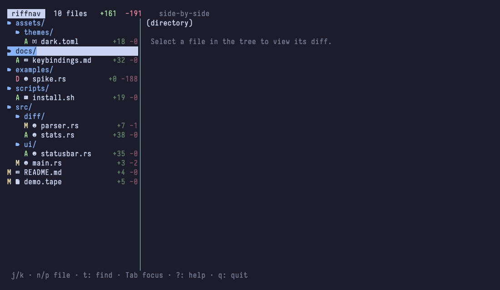

# riffnav

A git diff pager with a GitHub-style file tree.

> 🤖 **Built with AI.** riffnav — its code, tests, and docs — was written with AI assistance

riffnav shows a diff in a terminal UI: a file tree on the left, the
syntax-highlighted diff on the right. It's a Rust take on [diffnav][diffnav].



## Install

```sh
cargo install riffnav
```

A [Nerd Font][nerdfonts] is used for file icons. Without one, press `i` to switch
to `unicode` or `ascii` icons, or set `icon_style` in the config.

## Usage

`riffnav diff` and `riffnav show` take the same arguments as `git diff` and
`git show`:

```sh
riffnav diff              # unstaged changes
riffnav diff --staged
riffnav diff HEAD~3 -- src/
riffnav show              # the last commit
riffnav show <commit>
```

Or pipe in any unified diff:

```sh
git diff | riffnav
```

To use riffnav as git's pager for `git diff` and `git show`:

```sh
git config --global pager.diff riffnav
git config --global pager.show riffnav
```

### Diff views

```sh
riffnav diff                    # unstaged, plus untracked files
riffnav diff --staged           # staged
riffnav diff --all-uncommitted  # staged + unstaged + untracked, vs HEAD
riffnav diff --vs-base          # branch vs base (`<base>...HEAD`), the PR view
riffnav diff --all              # the branch's commits plus all uncommitted work
```

When there are no unstaged changes, a plain `riffnav diff` falls back to the
narrowest view that shows something. Press `d` to cycle views, or `1`–`5` to jump
to one. The base branch is detected from `origin/HEAD` or a local `main`/`master`;
set it with `--base <ref>` or `base_branch`.

Passing your own git arguments turns off view cycling and untracked files.
Arguments that suppress the diff, such as `--stat` or `--name-only`, leave nothing
to show.

## Keys

| Key | Action |
|-----|--------|
| `j` / `k` | Move in the tree or the diff |
| `n` / `p` | Next / previous file |
| `J` / `K` | Next / previous change, across files |
| `Ctrl-d` / `Ctrl-u`, `Space` / `b` | Half page / page |
| `g` / `G` | Top / bottom |
| `Tab`, `←` / `→` | Switch focus between tree and diff |
| `Enter` | Expand / collapse folder |
| `/` | Search the whole diff; `n` / `N` step through matches |
| `t` | Fuzzy-find a file |
| `s` | Toggle side-by-side / unified |
| `e` | Toggle the file tree |
| `i` / `T` | Cycle icon style / switch theme |
| `y` | Copy the file's path |
| `v` / `V` | Mark viewed / next unviewed file |
| `d`, `1`–`5` | Cycle / pick the diff view |
| `r` | Reload the diff |
| `+` / `-` | More / less context |
| `o` | Open the file in `$EDITOR` |
| `c` / `x` | Comment or reply / delete a comment |
| `]` / `[` | Next / previous comment |
| `m` | Jump to the other end of a moved or copied line |
| `z` | Zoom riffnav's pane (in [herdr](#herdr)) |
| `S` | Send new comments to the agent in this tab (in the [herdr](#herdr) app) |
| `W` | Open the branch's pull request in the browser (needs `gh`) |
| `?` | Help |
| `q` / `Esc` | Quit |

## Features

- **Moved and copied code.** Moved code is muted with a note saying where it
  went. Added code that duplicates existing code gets a `≡ copied from` note.
  `m` jumps between the two ends.
- **Viewed marks.** `v` marks a file viewed, like GitHub's checkbox. Marks are
  kept per repository and branch, and a file reverts to unviewed when it changes.
- **Review comments.** `c` leaves a note on a line. `Ctrl-O` moves a long note
  into `$EDITOR`. When the file is edited, a note follows its code. If its line
  was rewritten or deleted, it moves to the replacement or the nearest line left,
  marked outdated.
- **Correct colors mid-file.** When riffnav runs git itself, it reads the full
  file, so a hunk inside a block comment or string is colored correctly.

### Comments from an agent

`riffnav comment` lets an agent read and write the same comments. They show up
in an open riffnav window right away.

```sh
riffnav comment context    # files and lines that can be commented on
riffnav comment add --file src/app.rs --new-line 103 --body "No backoff here."
riffnav comment list --json
```

`riffnav skill` prints a skill that teaches an agent these commands.

## Configuration

riffnav reads `~/.config/riffnav/config.toml` (or `$XDG_CONFIG_HOME`), or a file
given with `--config`. See [`config.example.toml`](config.example.toml) for every
option.

## herdr

Inside [herdr](https://herdr.dev), the terminal multiplexer or the desktop app,
`z` toggles zoom on riffnav's pane. Quitting undoes a zoom riffnav made.

In the desktop app, `S` tells the agent in riffnav's tab about the comments you
left since the last `S`, by typing a one-line `[riffnav]` notice into its
terminal. With several agents in the tab, riffnav asks which one and remembers
the choice. A busy agent gets the notice once it's free; the header shows what
is unsent or queued.

## License

MIT

[diffnav]: https://github.com/dlvhdr/diffnav
[nerdfonts]: https://www.nerdfonts.com/
